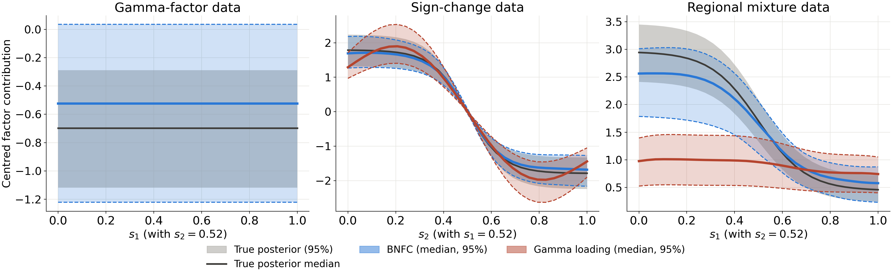
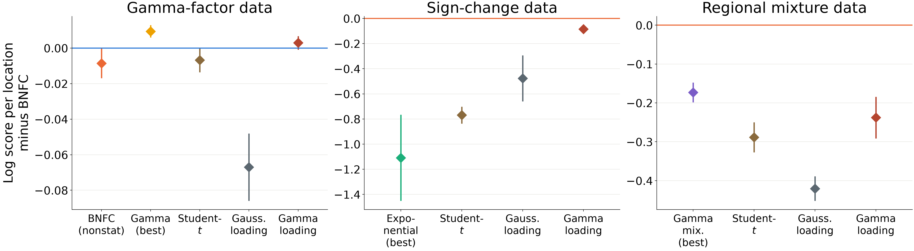
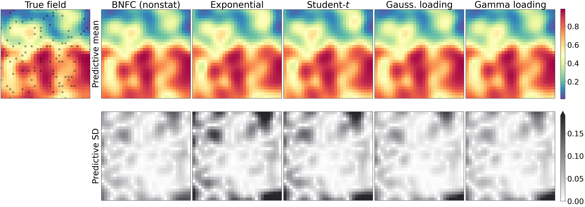
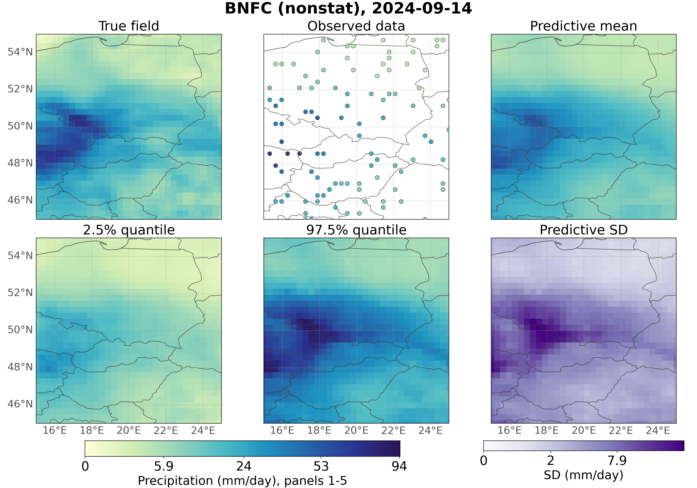
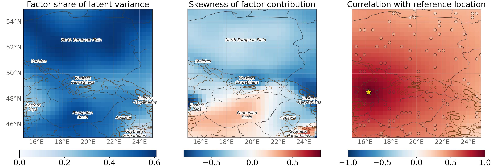

<h1 align="center">Bayesian Neural Factor Copula (BNFC)</h1>

<p align="center">
  <em>Reproducible code for “Bayesian Neural Factor Copula Model for Spatial Data”</em>
</p>

<p align="center">
  
  
  
  
  
  
</p>

<p align="center">
  <a href="#highlights">Highlights</a> ·
  <a href="#setup">Setup</a> ·
  <a href="#era5-data">ERA5 data</a> ·
  <a href="#reproducing-the-results">Reproducing the results</a> ·
  <a href="#where-each-table-and-figure-comes-from">Tables &amp; figures</a> ·
  <a href="#repository-layout">Layout</a>
</p>

This repository contains the code that produces every numerical result, table and figure in the
manuscript *Bayesian Neural Factor Copula Model for Spatial Data* and its Supplementary
Material:
- the **simulation study**: Section 5.1 of the manuscript and Section S6 of the supplement;
- the **ERA5 precipitation application**: Sections 5.2–5.3 and S7–S8.

Two shell scripts run the whole workflow, from data generation to the final tables and figures.

In a factor copula, a Gaussian process plus one common latent factor defines the dependence.
**BNFC** replaces the parametric factor with a **neural network of a single uniform variable
and, optionally, of the location**:

$$
W(\mathbf{s}) = Z(\mathbf{s}) + g(V, \mathbf{s}), \qquad V \sim U(\theta_1, \theta_2).
$$

The likelihood still needs only one-dimensional integrals, but the model can approximate any
factor distribution. Its location-dependent form lets the effect of the factor change over
space in strength, shape **and sign**. Inference combines a Monte Carlo likelihood, exact
implicit gradients, variational inference and stochastic gradient MCMC for the network weights.

---

## Highlights

### BNFC recovers a factor whose effect varies over space

In the *sign-change* and *regional mixture* scenarios, the effect of the factor differs between
regions of the domain. Along a transect, the factor posterior of BNFC (nonstat) closely follows
the true posterior. A common factor copula can only shift the whole field by the same amount.

<p align="center">
  
  <br>
  <sub><b>Supplement Figure S7.</b> Posterior of the centered factor contribution along a
  transect (gray: true posterior; colors: fitted models).</sub>
</p>

### Held-out log score over the full grid

<p align="center">
  
  <br>
  <sub><b>Manuscript Figure 1.</b> Held-out copula log score at all 900 grid locations minus
  that of BNFC (stat) for the gamma-factor data and of BNFC (nonstat) for the other two
  scenarios (±2 paired standard errors). In the two scenarios in which the effect of the factor
  varies over space, every competitor falls below BNFC.</sub>
</p>

### Sharper predictions where the dependence structure matters

<p align="center">
  
  <br>
  <sub><b>Supplement Figure S3(b).</b> Sign-change data, one test replicate, on the copula
  scale: true field and predictive means (top), predictive standard deviations (bottom).</sub>
</p>

### ERA5 daily precipitation over central Europe

BNFC (nonstat) has the best held-out scores of all copula models on 200 test days of 2024. Its
factor changes the sign of its skewness over the domain.

<p align="center">
  
  <br>
  <sub><b>Manuscript Figure 2.</b> 14 September 2024, the wettest day of the test period:
  predictions of BNFC (nonstat) given 100 observed locations.</sub>
</p>

<p align="center">
  
  <br>
  <sub><b>Manuscript Figure 3.</b> Share of the latent variance due to the factor, skewness of
  the factor contribution, and correlation with a location near Vienna.</sub>
</p>

---

## Setup

Run every command from the root of this repository.

```bash
git clone https://github.com/pratiknag/BNFC_code.git
cd BNFC_code

# main environment (GPU)
python3.9 -m venv env
env/bin/pip install -r requirements.txt
```

The Bayesian transport map baseline (Table S6 only) needs the `batram` package. `batram` requires
Python ≥ 3.10, so it goes in a separate CPU environment:

```bash
python3.11 -m venv env_batram
env_batram/bin/pip install torch --index-url https://download.pytorch.org/whl/cpu
env_batram/bin/pip install -r requirements_batram.txt
```

The run scripts use `env/bin/python` and `env_batram/bin/python` by default. Other interpreters
can be set with `PYTHON` and `BATRAM_PYTHON`. Without `env_batram/`, the transport map stages are
skipped and everything else still runs.

> [!NOTE]
> A CUDA GPU with **24 GB** of memory is needed. All results were computed on one NVIDIA RTX 4090
> with 32 CPU threads and 126 GB of RAM. The transport map baseline for the application needs
> about 45 GB of RAM.

---

## ERA5 data

*Application only. The simulation data are generated by the code.*

1. Create a free account at the [Copernicus Climate Data Store](https://cds.climate.copernicus.eu).
2. Put your API key in `~/.cdsapirc` ([instructions](https://cds.climate.copernicus.eu/how-to-api)).
3. Accept the licence of *ERA5 hourly data on single levels*.
4. Run:

```bash
env/bin/python src/python_scripts/download_era5.py --out_dir era5/
```

This downloads hourly total precipitation over 15°E–25°E, 45°N–55°N for 1994–2024, one file per
year (about 0.5 GB in total), to `era5/era5_precipitation_<year>/`.

---

## Reproducing the results

```bash
mkdir -p logs
setsid nohup bash run_simulations.sh > logs/run_simulations.log 2>&1 < /dev/null &
# after it has finished:
ERA5_DIR=era5/ setsid nohup bash run_application.sh > logs/run_application.log 2>&1 < /dev/null &
```

| Script | What it does | Runtime |
|---|---|:---:|
| [`run_simulations.sh`](run_simulations.sh) | simulation study: data, all model fits, predictions, scores, tables and figures | ≈ 11 h GPU + ≈ 5 h CPU |
| [`run_application.sh`](run_application.sh) | ERA5 application: data, all fits, predictions, scores, tables and figures, Vecchia fit, timing benchmark, transport map | ≈ 30 h |

> [!TIP]
> - **Logs.** Each stage writes its log to `logs/`.
> - **Resuming.** An interrupted run is resumed by starting the script again. Fitting stages
>   whose outputs exist are skipped. Predictions, scores, tables and figures are always
>   recomputed.
> - **`FORCE=1`** regenerates the data and refits every model.
> - **`DRY_RUN=1`** prints every command without running it.

> [!IMPORTANT]
> Run the two scripts one after the other, not at the same time: a BNFC (nonstat) fit fills the
> GPU. All stages use fixed seeds. GPU computations are not bit-for-bit deterministic, so a
> refit can differ from the reported values in the last digits.

<details open>
<summary><b>Stages of <code>run_simulations.sh</code></b></summary>

1. **Data.** Three scenarios on a 30 × 30 grid, each with 2,000 training and 100 test
   replicates and 100 observed locations:
   - (i) gamma-factor data (`dataGen_Gamma.py`)
   - (ii) sign-change data (`dataGen_SignChange.py`)
   - (iii) regional mixture data (`dataGen_MixGamma.py`)
2. **Fits.**
   - BNFC (stat, nonstat) with early stopping and pSGLD weight samples (`Train_BNFC.py`; settings
     in `configs/bnfc_simulations.conf`).
   - Common factor copulas with exponential, gamma, Pareto and gamma-mixture factors, fitted by
     HMC/NUTS (`train_model_single_factor_HMC_NUTS.py`).
   - The Student-t copula (`gsm_t_copula.py`).
   - The Gaussian and gamma loading copulas (`M1_gaussian_rank1.py`,
     `M2_gamma_varying_loading.py`).
3. **Posterior predictive simulation**, conditioning on 100 observed locations (`results/`) and
   on 25 of them (`results_n25/`).
4. **Held-out copula log score** (`heldout_loglik.py`).
5. **Tables and figures.**
   - `plot_BNFC_results.py`, `plot_calibration.py` and `factor_posterior.py`.
   - Paired comparisons (`compare_M1_M2.py`).
   - The rows of Table 1 (`make_main_tables.py`).
6. **Bayesian transport map** at the observed locations (`transport_map_baseline.py`, CPU).
7. **Tail-flexibility figures** of Section S3 (`Copula_tail_dependence.py`).

</details>

<details open>
<summary><b>Stages of <code>run_application.sh</code></b></summary>

1. **Data** (`dataGen_precipitation.py`).
   - Two-day mean precipitation on a 32 × 32 grid, with a randomized empirical PIT.
   - 10,591 training days (1994–2022) and 200 test days (15 June – 31 December 2024).
   - 100 observed locations.
2. **Marginal quantile network**, shared by all models.
3. **Preliminary BNFC (stat) fit.** Its range and nugget define the Gaussian component of the
   competitors.
4. **Common factor copulas** (HMC/NUTS) and the **Student-t copula**.
5. **BNFC (stat), BNFC (nonstat) and the loading copulas.** BNFC (nonstat) uses
   `configs/bnfc_application.conf`. The Gaussian loading copula is fitted with K = 25 and 49,
   followed by the gamma loading copula.
6. **Predictions, held-out log scores, paired comparisons.**
7. **Tables and figures.** These include the rows of Table 2. The ETOPO1 relief is downloaded
   automatically.
8. **Complete data.** BNFC (nonstat) is fitted to all 1,024 locations with the Vecchia
   approximation (m = 30). The script then predicts on an 80 × 80 grid and runs the timing
   benchmark.
9. **Bayesian transport map** on the 2,000 most recent training days, with 100 Adam steps.

</details>

<details>
<summary><b>Optional: selection of the BNFC settings</b></summary>

The selected settings are already in [`configs/`](configs/), so these scripts need not be rerun.
They never use the test data.

- [`run_bnfc_sim_tuning.sh`](run_bnfc_sim_tuning.sh) (≈ 28 h). It fits candidate settings to
  simulation replicates 0–1799 and scores them on replicates 1800–1999. Results go to
  [`experiments/bnfc_sim/`](experiments/bnfc_sim/) (Table S7).
- [`run_bnfc_app_tuning.sh`](run_bnfc_app_tuning.sh), run with
  `experiments/bnfc_app/configs_r1.txt` and then with `configs_r2.txt`. It fits candidate
  configurations to 1994–2021 and scores them on the days of 2022. Results go to
  [`experiments/bnfc_app/summary.csv`](experiments/bnfc_app/summary.csv).

</details>

---

## Where each table and figure comes from

All paths are written by the run scripts. *Assembled from* means that the table in the paper
was typeset from the listed files.

<details open>
<summary><b>Manuscript</b></summary>

| Item | Content | Output file(s) |
|---|---|---|
| Table 1 | simulation study, main comparison | `results/simulation_table_rows.tex` (from `results_M1_M2/simulations/<scenario>/comparison.csv`, `predictions.npz`, `simulations_*/models/*.json`) |
| Figure 1 | held-out log score minus BNFC | `results/figures/logscore_differences.png` |
| Table 2 | ERA5, main comparison | `results_application/figures/application_table_rows.tex` |
| Figure 2 | ERA5 predictions, 14 September 2024 | `results_application/figures/map_bnfc_nonstat_2024-09-14_nugget0.1.png` |
| Figure 3 | variance share, skewness and correlation maps | `results_application/figures/inference_factor_maps.png` |

</details>

<details>
<summary><b>Supplementary Material</b></summary>

| Item | Content | Output file(s) |
|---|---|---|
| Table S1 | positioning among related approaches | literature review, no code |
| Figures S1–S2 | tail flexibility | `results/figures/zeta_plot.png`, `correlation_matrices.png` |
| Figure S3 | predictions for one test replicate | `results/figures/heatmaps_simulations_{gamma,signchange,mixgamma}_rep2000.png` |
| Table S2 | all simulation models | `results/figures/summary_table.tex` |
| Figure S4, Table S3 | calibration, 100 conditioning locations | `results/figures/calibration.png`, `calibration_table.tex` |
| Table S4 | calibration, 25 conditioning locations | `results_n25/figures/calibration_table.tex`, `calibration.png` |
| Figure S5 | PIT histograms | `results/figures/pit_histograms.png`, `results_n25/figures/pit_histograms.png` |
| Table S5, Figure S6 | 25 conditioning locations | `results_n25/figures/summary_table.tex`, `heatmaps_simulations_mixgamma_rep2000.png` |
| Table S6 | Bayesian transport map | assembled from `results_M1_M2/transport_map/comparison.csv`, `results_M1_M2/transport_map_application/comparison.csv` |
| Figure S7 | factor posterior along a transect | `results/figures/factor_posterior.png` |
| Table S7 | selection of the BNFC settings | assembled from `experiments/bnfc_sim/validation_summary.csv`, `selected.csv` |
| Table S8 | all ERA5 models | assembled from `results_M1_M2/application/application_precipitation_v2/comparison.csv`, `predictions.npz`, `application_precipitation_v2/models/*.json` |
| Figure S8 | implied and empirical dependence | `results_application/figures/inference_dependence.png` |
| Figure S9 | factor over the test period | `results_application/figures/inference_factor_timeseries.png` |
| Table S9 | computing times, exact and Vecchia | `results_application_full/benchmark/vecchia_benchmark.csv` |
| Figure S10 | complete-data predictions, 80 × 80 grid | `results_application_full/dense/map_dense_2024-07-02.png` |

Some numbers in the text of Sections 5.3 and S7 come from three summary files in
`results_application/figures/`: `inference_summary.json`, `bayes_insights.json` and
`topography_summary.json`.

</details>

---

## Repository layout

| Path | Contents |
|---|---|
| [`run_simulations.sh`](run_simulations.sh), [`run_application.sh`](run_application.sh) | the two end-to-end pipelines |
| [`configs/`](configs/) | BNFC settings of the simulations and of the application |
| [`run_bnfc_sim_tuning.sh`](run_bnfc_sim_tuning.sh), [`run_bnfc_app_tuning.sh`](run_bnfc_app_tuning.sh), [`experiments/`](experiments/) | optional selection of the BNFC settings, with the summaries of the runs reported in the paper |
| [`src/python_scripts/`](src/python_scripts/) | data generation, model fitting, prediction, scoring, tables and figures (every script has `--help`) |
| [`assets/`](assets/) | figures shown in this README |
| [`README.txt`](README.txt) | plain-text version of this description |

<details>
<summary><b>Scripts in <code>src/python_scripts/</code></b></summary>

| Script | Purpose |
|---|---|
| `Train_BNFC.py`, `Copula_BNFC.py`, `utils.py` | BNFC fit (variational inference, early stopping, pSGLD) and posterior predictive simulation |
| `dataGen_Gamma.py`, `dataGen_SignChange.py`, `dataGen_MixGamma.py` | simulation data |
| `download_era5.py`, `dataGen_precipitation.py` | ERA5 download and data on the 32 × 32 grid |
| `train_model_single_factor_HMC_NUTS.py`, `Copula_single_factor.py` | common factor copulas |
| `gsm_t_copula.py` | Student-t copula (Gaussian scale mixture) |
| `M1_gaussian_rank1.py`, `M2_gamma_varying_loading.py` | Gaussian and gamma loading copulas |
| `transport_map_baseline.py` | Bayesian transport map (`batram`) |
| `heldout_loglik.py`, `compare_M1_M2.py` | held-out copula log score, Vecchia benchmark, paired comparisons |
| `make_main_tables.py` | rows of Tables 1 and 2 of the manuscript |
| `plot_BNFC_results.py`, `plot_calibration.py`, `factor_posterior.py`, `Copula_tail_dependence.py` | simulation tables and figures |
| `plot_application.py`, `plot_application_nugget_map.py`, `application_bayes_insights.py`, `application_topography.py`, `predict_dense_grid.py` | application tables and figures |
| `bnfc_app_experiment.py` | helper of the application selection runs |

</details>

Folders created by the run scripts are listed in [`.gitignore`](.gitignore):
- **Data and fitted models:** `simulations_*/`, `application_precipitation_*/`.
- **Results:** `results*/`.
- **Logs and downloads:** `logs/`, `era5/`.

---

## License

The code is released under the [MIT License](LICENSE).
